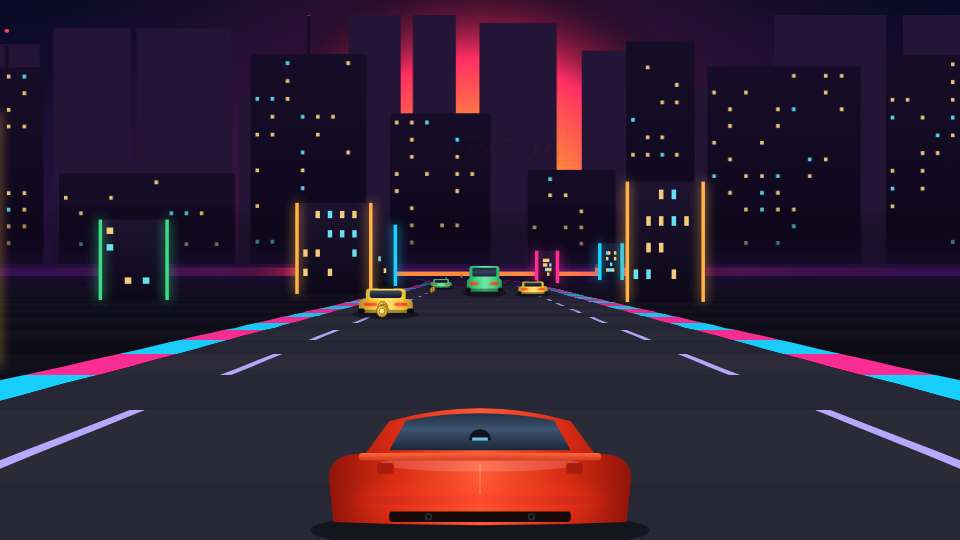
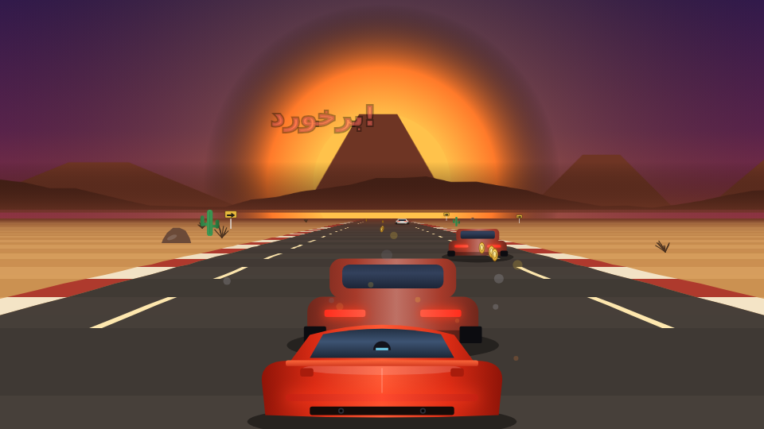
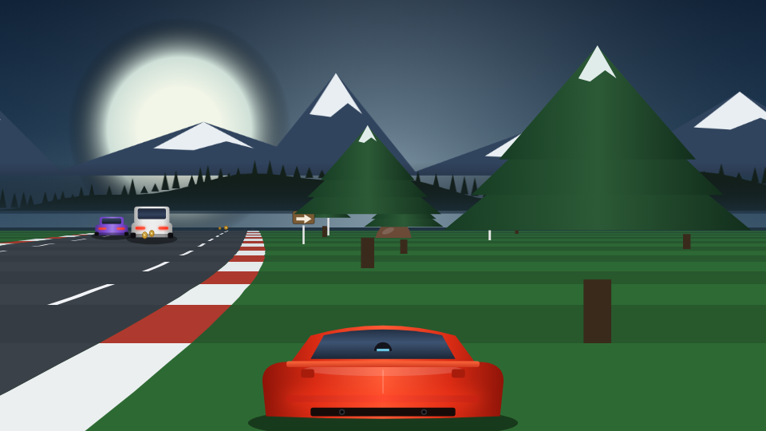

# گازِ آخر | FULL THROTTLE 🏁

یک بازی ماشین‌سواری مسابقه‌ایِ سه‌بعدی‌نما (Pseudo‑3D) که کاملاً با **HTML + CSS + JavaScript خالص** نوشته شده — بدون هیچ کتابخانه یا فریم‌ورکی. انتخاب از میان **سه مسیر متفاوت** در ایران و رانندگی با **کیبورد**.

A pseudo-3D arcade racer built with vanilla HTML5 Canvas — no libraries. Three distinct routes set in Iran, fully keyboard-driven.

## مسیرها | The Routes

| مسیر | سبک | چالش |
|------|------|------|
| **تهرانِ شب** — TEHRAN NIGHTS | بزرگراه نئونیِ خیس از باران | ترافیک سنگین، پیچ‌های شهری |
| **کویر لوت** — LUT DESERT | اتوبان طلایی زیر آفتاب غروب | سرعت‌های بسیار بالا، ترافیک کم |
| **گردنه‌ی البرز** — ALBORZ PASS | گردنه‌ی کوهستانی مه‌آلود و برفی | پیچ‌های تند و سر بالایی‌های سخت |





## کنترل‌ها | Controls

| کلید | عمل |
|------|------|
| `↑` / `W` | گاز |
| `↓` / `S` | ترمز |
| `←` `→` / `A` `D` | فرمان |
| `Space` (نگه‌داشتن) | نیترو |
| `P` / `Esc` | توقف / ادامه |
| `M` | قطع / وصل صدا |
| `Enter` | شروع سریع |
| `1` `2` `3` | انتخاب مسیر |
| `R` | تلاش دوباره بعد از پایان |

## امکانات | Features

- رندرر Pseudo‑3D اختصاصی روی Canvas2D (خط جاده، تپه‌ها، مه، پارالاکس آسمان)
- سه محیط کاملاً متفاوت با پالت رنگی، اسپرایت‌ها و افق‌های تولیدشده با کد
- ترافیک زنده با ماشین‌های سدان/شاسی‌بلند/اتوبوس (و تاکسی!)، برخورد و سبقتِ نزدیک با امتیاز
- جمع‌کردن سکه، نیترو با شعله‌ی اگزوز، ذرات (دود، جرقه، گرد، کاغذرنگین)
- امتیاز، بهترین رکوردِ هر مسیر در `localStorage`، پاداش سرعت
- صدای موتور/برخورد/سکه با Web Audio API — بدون فایل صوتی
- رابط کاملاً فارسی (RTL)، راست‌به‌چپ، با فونت وزیرمتن و اعداد Orbitron

## اجرا | Run locally

چون فقط فایل‌های استاتیک است، هر سرور ساده‌ای کار می‌کند:

```bash
# روش اول — پایتون
python3 -m http.server 8080

# روش دوم — node
npx serve .
```

بعد `http://localhost:8080` را باز کنید. برای دیدن پیش‌نمایش زنده کافی است فایل `index.html` را با هر سرور استاتیک دیگری سرو کنید.

## ساختار | Structure

```
index.html        صفحه و تمام لایه‌های DOM (منو، انتخاب مسیر، HUD، پنل‌ها)
css/style.css     استایل کامل رابط بازی (تم نئون، RTL)
js/game.js        موتور بازی: ساخت مسیر، رندر pseudo-3D، فیزیک، ترافیک، صدا
assets/*.jpg      آرت‌ورک منو و کارت‌های مسیر (تولیدشده با هوش مصنوعی)
docs/*.png        اسکرین‌شات‌های واقعی از رندر بازی
```

ساخته شده با ❤️ برای مدارس/دوست‌داران بازی‌های رترو. PRs and ideas welcome!
